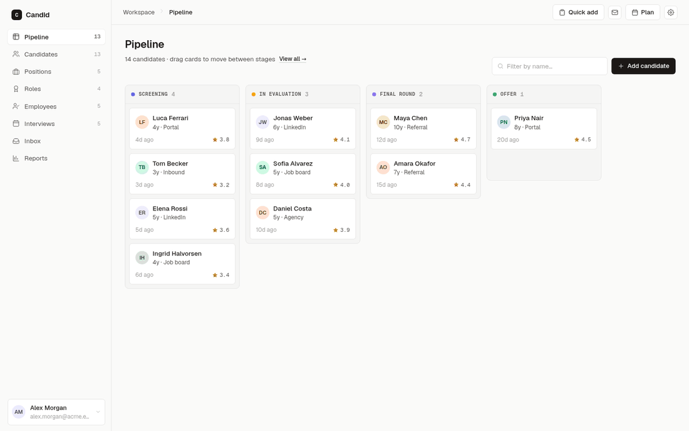
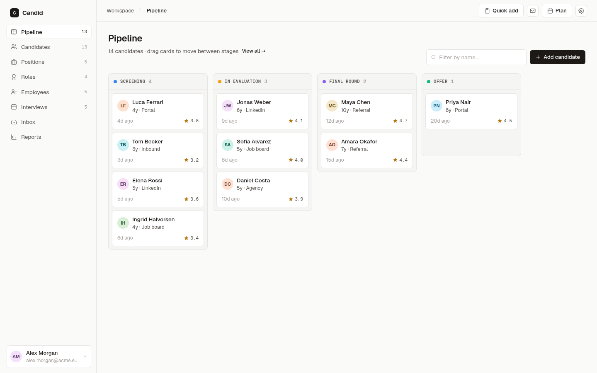
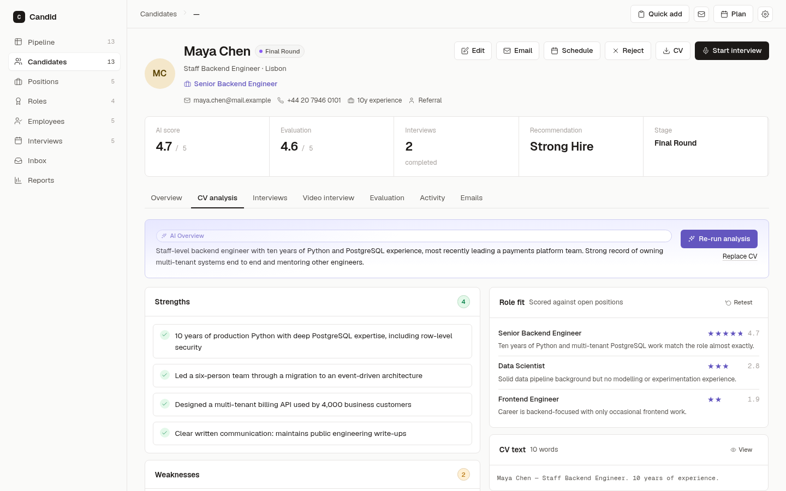
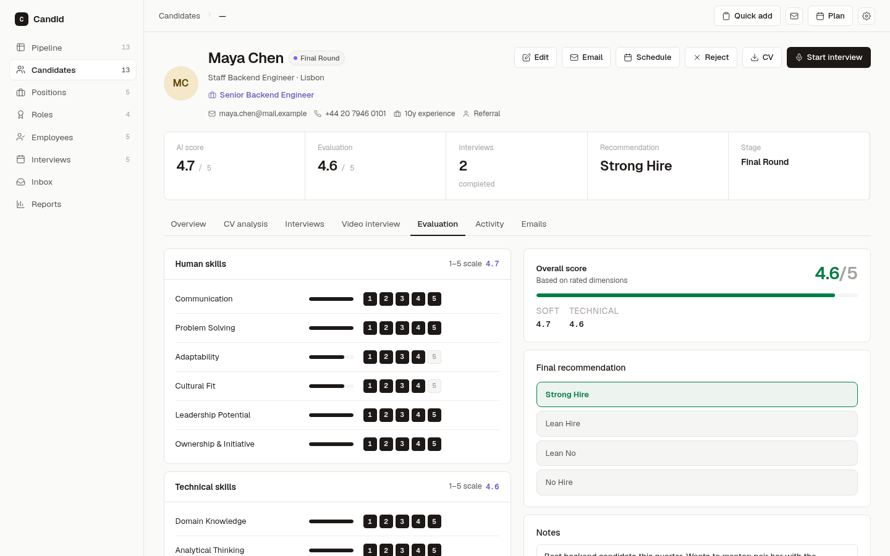
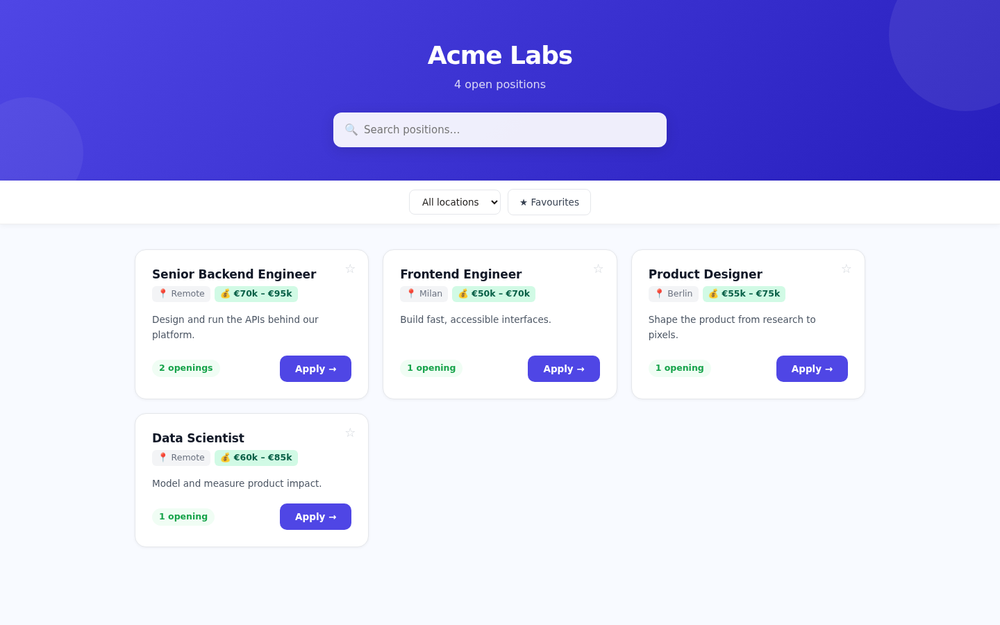

# Candid

**Open-source AI recruiting assistant.** Candid reads every CV, transcribes every interview and keeps each organisation's data locked to its own rows. People keep the decisions.

[](https://github.com/LorenzoSciuto/candid/actions/workflows/release.yml)
[](https://github.com/LorenzoSciuto/candid/releases)
[](LICENSE)
[](https://www.python.org)
[](https://fastapi.tiangolo.com)
[](https://sqlmodel.tiangolo.com)
[](https://docs.astral.sh/uv/)
[](https://www.postgresql.org)
[](https://react.dev)



| Hiring pipeline | AI analysis of a CV |
|---|---|
|  |  |
| **Evaluation scorecard** | **Public job portal** |
|  |  |

<sub>Screenshots show fictional demo data.</sub>

## Features

- **CV analysis:** upload a PDF/DOCX and get a fit score, strengths, gaps and interview questions, matched against every open position.
- **Hiring pipeline:** drag-and-drop Kanban with stages each organisation configures, plus history and an activity log.
- **Interviews:** live speech-to-text in the browser, Whisper transcription of recordings and AI summaries.
- **Async video interviews:** candidates answer recorded questions from any browser, with no account.
- **Evaluation:** scorecards, recommendations and AI-drafted rejection emails.
- **Positions, roles and people:** job descriptions, headcount, an employee directory and performance reviews.
- **Branded public job portal** where candidates apply with their CV.
- **Bring your own AI:** OpenAI, Anthropic, Gemini or Groq per organisation, with automatic fallback and keys encrypted at rest.
- **Multi-tenant:** isolation is enforced in the code *and* by PostgreSQL Row-Level Security.
- **Zero-build frontend** in English, Italian and German.

## Quick start

Requirements: [uv](https://docs.astral.sh/uv/), Docker, Python 3, and optionally `ffmpeg` (to transcribe video recordings).

```bash
git clone https://github.com/LorenzoSciuto/candid.git && cd candid
cp backend/.env.example backend/.env   # fill FERNET_KEY, SESSION_SECRET, GOOGLE_CLIENT_ID (the file says how)
./scripts/server.sh                    # PostgreSQL + migrations + API on http://localhost:8000 (/docs)
./scripts/client.sh                    # frontend on http://localhost:8080
```

Sign in with Google, create your organisation and add an AI provider key in **Settings → AI**.

## Documentation

- [Development](docs/DEVELOPMENT.md): configuration, commands, tests, migrations, releases, deployment.
- [Architecture](docs/ARCHITECTURE.md): layers, authentication, tenant isolation, security, frontend.
- [Roadmap](docs/ROADMAP.md): project status, known limitations, what comes next.
- [Contributing](CONTRIBUTING.md) · [Security policy](SECURITY.md) · [Code of conduct](CODE_OF_CONDUCT.md)

> **Responsible use.** Candid scores and summarises candidates but never rejects anyone by itself. AI-assisted hiring is regulated in many jurisdictions (for example as *high-risk* under the EU AI Act), so check your obligations before using it on real applicants.

## License

[MIT](LICENSE) © Wennovate

**Third-party notice: PyMuPDF is AGPL.** Candid's own code is MIT, but PDF text extraction uses [PyMuPDF](https://pymupdf.readthedocs.io/), which is dual-licensed under the [GNU AGPL v3](https://www.gnu.org/licenses/agpl-3.0.html) or a commercial Artifex licence. If you run or distribute Candid with PyMuPDF installed, the AGPL applies to that combined deployment: among other things, users who reach it over a network must be offered its complete source code. To stay under MIT terms only, buy the commercial licence or replace the single call in `backend/src/candid/services/cv_extractor.py` with a permissively licensed PDF library.
